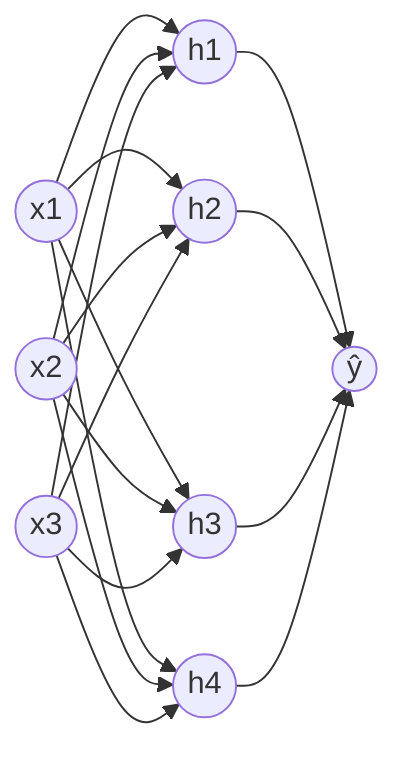
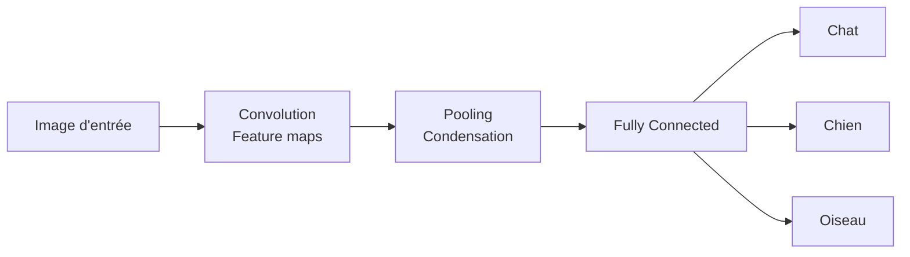
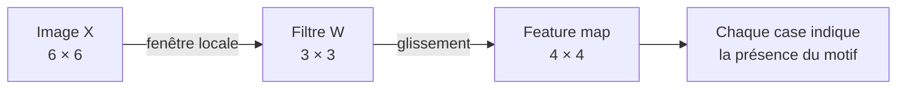
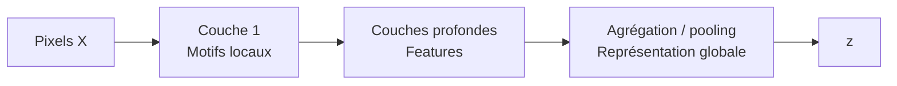
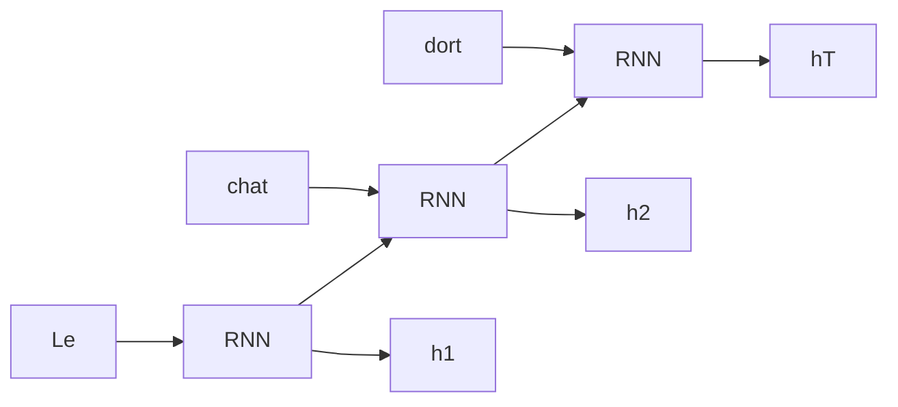
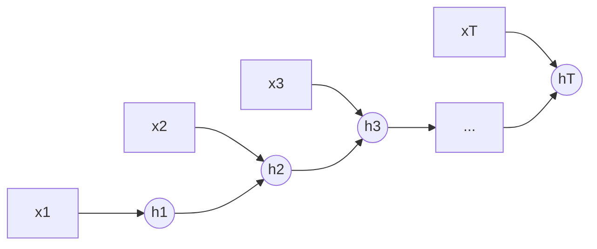
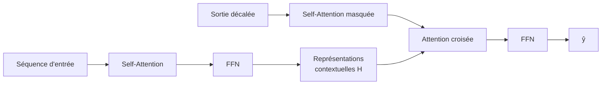
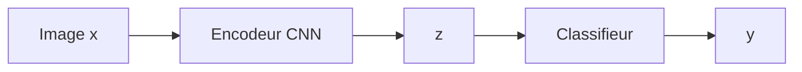
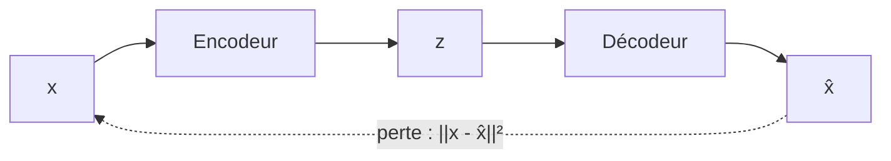
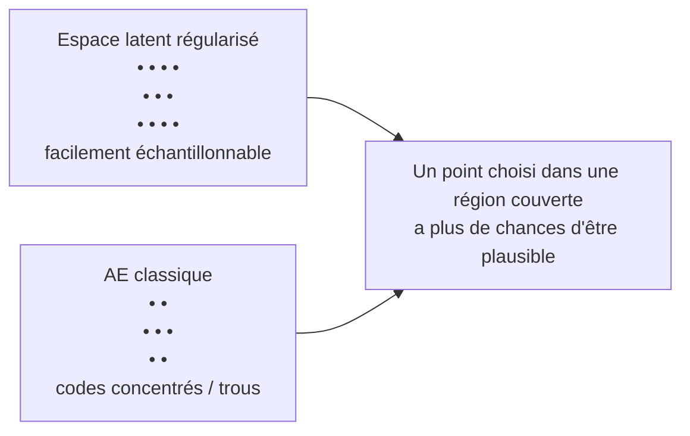

# Semaine 1 — Schémas visuels complets

Cette page rassemble les schémas pédagogiques de la semaine 1 sous une forme directement rendue par GitHub. Ils correspondent aux figures présentes dans le support d'origine.

## 1. Réseau de neurones simple : entrée → couche cachée → sortie



**Lecture :** l'entrée $x$ est transformée en représentation cachée $z=\sigma(W_1x+b_1)$, puis en sortie $\hat y=W_2z+b_2$.

---

## 2. Fonction paramétrée et apprentissage par la perte

```mermaid
flowchart LR
    X[x — entrée] --> N[Réseau fθ\nfonction paramétrée] --> Y[ŷ — sortie]
    Y --> L[Perte L(ŷ,y)]
    L -->|mise à jour de θ| N
```

---

## 3. CNN : de l'image aux features puis à la classification



Le CNN transforme progressivement l'espace brut des pixels en représentations plus utiles.

---

## 4. Convolution locale : image + filtre → feature map



La même matrice de poids $W$ est réutilisée à différentes positions de l'image.

---

## 5. Hiérarchie de représentations dans un CNN



**Intuition :** pixels → bords → textures → parties/objets → représentation globale $z$.

---

## 6. RNN : lecture séquentielle de « Le chat dort »



L'état caché est transmis d'un pas de temps au suivant et résume progressivement le passé.

---

## 7. RNN générique : séquence → représentation



$h_t$ représente la séquence jusqu'au temps $t$ ; $h_T$ peut servir de représentation globale de la séquence.

---

## 8. Transformer encodeur–décodeur



L'encodeur construit des représentations contextuelles ; le décodeur utilise self-attention masquée et attention croisée.

---

## 9. Multi-Head Attention

```mermaid
flowchart LR
    X[X] --> H1[Tête 1\nQ1 K1 V1]
    X --> H2[Tête 2\nQ2 K2 V2]
    X --> HH[Tête h\nQh Kh Vh]
    H1 --> A1[A1]
    H2 --> A2[A2]
    HH --> AH[Ah]
    A1 --> C[Concat]
    A2 --> C
    AH --> C
    C --> WO[Wᴼ]
    WO --> MHA[MHA(X)]
```

Chaque tête apprend des projections différentes et peut capturer des relations complémentaires.

---

## 10. Encodeur CNN : représentation utile mais pas encore mécanisme génératif



> Le code latent $z$ est obtenu à partir d'une observation $x$. Ce schéma ne définit pas encore comment produire un nouveau $z$ sans observation d'entrée.

---

## 11. Exemple de génération à partir d'un latent échantillonné

```mermaid
flowchart LR
    Z[z ~ p(z)] --> D[Décodeur] --> X[x]
```

Ici, la génération commence par l'échantillonnage d'un latent puis son décodage.

---

## 12. Autoencodeur classique



L'objectif principal est de reconstruire l'entrée : $x \approx \hat x$.

---

## 13. Espace latent régularisé vs codes d'un AE classique



Un autoencodeur classique peut laisser des zones du latent mal couvertes ; une régularisation probabiliste vise à rendre l'échantillonnage plus contrôlé.

---

## 14. Reconstruction et génération : deux chemins différents

```mermaid
flowchart TD
    X[x] --> Z[z = encode(x)]
    Z --> R[Reconstruction\nx̂ = decode(z)\nobjectif : x ≈ x̂]
    Z -. représentation apprise .-> G
    P[z′ ~ p(z)] --> G[Génération\nx′ ~ pθ(x|z′)\nobjectif : x′ plausible / nouveau]
```

**Reconstruction :** on dispose d'une observation $x$ et on cherche à la retrouver.  
**Génération :** on cherche à produire une nouvelle observation plausible, sans observation cible à reconstruire.

---

## Correspondance avec le cours

| Figure | Notion principale |
|---|---|
| 1–2 | NN, couche cachée, représentation et apprentissage |
| 3–5 | CNN, convolution, feature maps et hiérarchie |
| 6–7 | RNN et état caché |
| 8–9 | Transformer, self-attention et multi-head attention |
| 10–13 | espace latent, encodeur/décodeur et échantillonnage |
| 14 | reconstruction vs génération |

Ces schémas complètent les huit chapitres Markdown de la semaine 1 afin que le contenu textuel, les équations, les exemples, les exercices et les représentations visuelles soient tous consultables dans GitHub.
